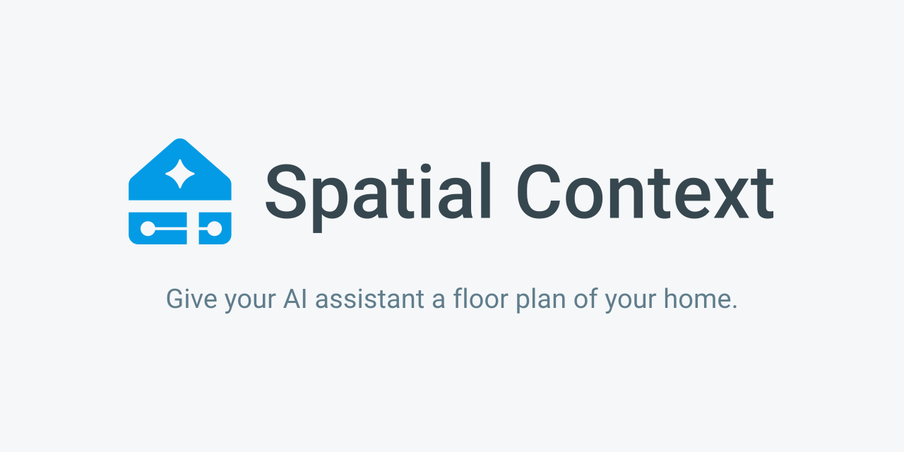
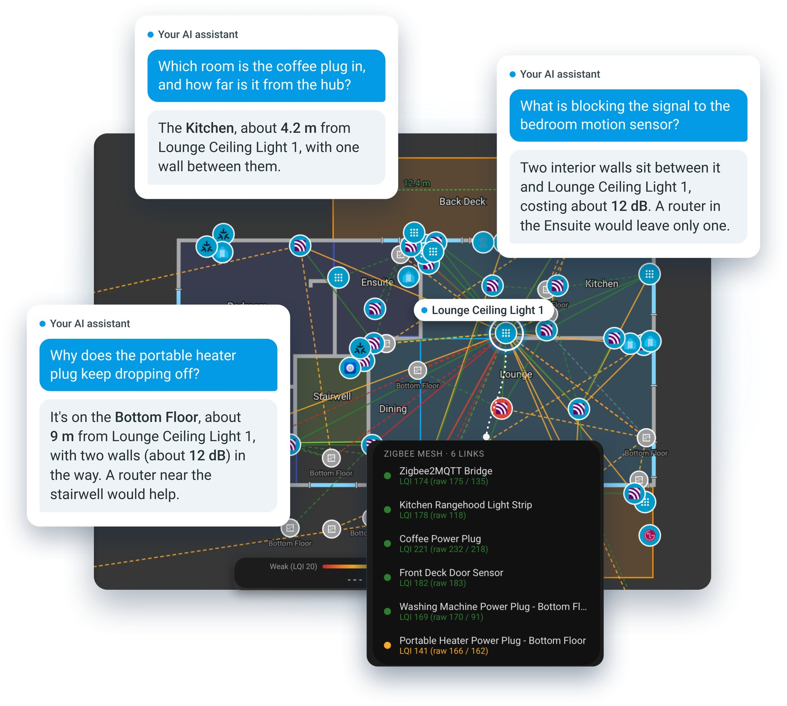

<picture>
  <source media="(prefers-color-scheme: dark)" srcset="brand/extras/social-preview-dark-1280x640.png">
  
</picture>

Home Assistant knows your devices by name and area, but not where anything actually *is*: how far the hallway sensor is from the router, which walls sit between a Zigbee bulb and its parent, what's on the other side of the garage door. Spatial Context lets you trace your floor plans over the top of your house plans, place your real devices on them, and hand the result to an AI assistant, an automation or a script as real-world, measured data.

<picture>
  <source media="(prefers-color-scheme: dark)" srcset="site/public/screenshots/hero-dark.png">
  
</picture>

*An AI assistant answering questions about the home from its floor plan, beside the Top Floor with the Zigbee mesh layer on. The conversations are illustrations of what the map makes possible.*

## What you get

- **A floor-plan editor that looks like part of Home Assistant.** One tab per HA floor. Trace rooms and walls over your plans, add doors and windows, calibrate to real metres, and place your actual devices.
- **Data an AI can reason about.** Rooms, walls (with material, thickness and estimated signal loss), doors and windows, and every device's position in real units, from one action or an export.
- **A live Connectivity Map.** Zigbee, Wi-Fi, Matter/Thread and Bluetooth links drawn on your plan and coloured by signal quality, so weak spots are visible where they physically are.
- **A whole-property view.** Place each building on a site photo or a live street or aerial map, along with devices that live outdoors.
- **Works on a phone**, and in **English and German**, following your Home Assistant profile.

## Documentation

The full guide is at **<https://greminn.github.io/ha-spatial-context/>**:

- [What is Spatial Context?](https://greminn.github.io/ha-spatial-context/guide/what-is-spatial-context) and [your first floor plan](https://greminn.github.io/ha-spatial-context/guide/first-floor-plan)
- [Using the panel](https://greminn.github.io/ha-spatial-context/guide/using-the-panel), [placing devices](https://greminn.github.io/ha-spatial-context/guide/placing-devices) and [wall materials](https://greminn.github.io/ha-spatial-context/guide/wall-materials)
- [Connectivity Map](https://greminn.github.io/ha-spatial-context/guide/connectivity-map) (what each layer needs), the [Property tab](https://greminn.github.io/ha-spatial-context/guide/property-tab) and [Settings](https://greminn.github.io/ha-spatial-context/guide/settings)
- [Using the map with AI](https://greminn.github.io/ha-spatial-context/ai/using-ai), [the map data](https://greminn.github.io/ha-spatial-context/ai/map-data) and [automations and actions](https://greminn.github.io/ha-spatial-context/advanced/automations)
- [Reporting a problem](https://greminn.github.io/ha-spatial-context/advanced/reporting-a-problem)

## Installation

Needs **Home Assistant 2024.10** or newer, with your floors set up in **Settings → Areas → Floors**. Spatial Context isn't in the HACS default repository yet, so it's added as a custom repository. A submission to HACS is planned.

[](https://my.home-assistant.io/redirect/hacs_repository/?owner=Greminn&repository=ha-spatial-context&category=integration)

1. Click the button above, or in HACS choose **⋮ → Custom repositories**, paste `https://github.com/Greminn/ha-spatial-context` and set **Type** to **Integration**.
2. Install **Spatial Context**.
3. Restart Home Assistant, then **Settings → Devices & Services → Add Integration → Spatial Context**.

Prefer to copy files by hand? Put `custom_components/spatial_context/` into your `/config/custom_components/`. The [install guide](https://greminn.github.io/ha-spatial-context/guide/install) has the details.

**Stable releases and pre-releases.** HACS offers stable releases. When a fix or feature needs testing first, it may appear as a pre-release such as `1.0.1-beta.1`. A pre-release only shows up if you turn on **Show beta versions** for Spatial Context in HACS, so it never installs on its own. Pre-releases are for people happy to test and report back on the issue. Everyone else can ignore them.

## Quick start

1. Open **Spatial Context** from the sidebar and pick a floor tab.
2. Add a background image, then **Set Scale** by clicking two points a known distance apart.
3. **Trace Room** and **Trace Wall**, then **Place Device** to drop your devices on the plan.
4. Repeat for each floor, use **Align Floors** for floors that stack, and place buildings on the **Property** tab.

Changes save automatically. The [first floor plan walkthrough](https://greminn.github.io/ha-spatial-context/guide/first-floor-plan) covers each step.

## Using it with AI assistants and automations

`spatial_context.get_map` returns the whole layout (floors, rooms, walls with material and signal loss, doors, windows and every placed device in real units) as the action's response. It's the same data as **⋮ → Export JSON**.

```yaml
actions:
  - action: spatial_context.get_map
    response_variable: home_map
```

An assistant can work out which room a device is in, how far apart two devices are, and which walls sit between a Zigbee router and a flaky sensor, without knowing anything about the editor. See [the map data](https://greminn.github.io/ha-spatial-context/ai/map-data) for the full shape.

## Support the project

Spatial Context is a personal project, free and shared as is. If it's useful to you and you'd like to say thanks, you can [buy me an espresso](https://buymeacoffee.com/greminn). It's never expected, and bug reports and ideas are just as welcome.

<a href="https://buymeacoffee.com/greminn"></a>

## Feedback

Found a bug, or have an idea? Please [open an issue](https://github.com/Greminn/ha-spatial-context/issues). Problems and feature ideas are equally welcome, not just polished bug reports.

## Also from me

**Home Desk**: a place for everything that needs your attention in your smart home. Coming soon.

## Development and licence

Building, testing and deploying are covered in [docs/development.md](docs/development.md). The panel is built from `frontend/` (Lit and TypeScript) and the output is committed, so HACS and a manual copy need no build step.

[MIT](LICENSE)
